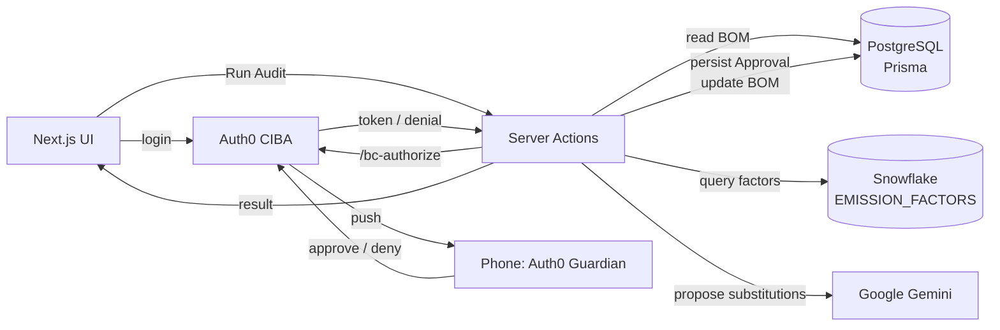

# GreenGate

Agent-driven embodied-carbon audit for construction Bills of Materials (BOMs),
with human-in-the-loop approvals via **Auth0 CIBA**.

## Why

Buildings account for ~37% of global energy-related CO₂ emissions (UNEP Global
Status Report). Most of that footprint is decided at the BOM stage — and it's
rarely audited. GreenGate makes the audit continuous and agent-driven, but
never autonomous: every proposed material substitution requires a site
manager's approval from their phone before any change is applied.

## Prize categories

This project targets the DEV.to Weekend Challenge — Earth Day Edition.

- **Best Use of Auth0 for Agents (primary)** — Client-Initiated Backchannel
  Authentication (CIBA) drives the human-in-the-loop approval on every
  proposed substitution. Each `Approval` row persists the Auth0 `auth_req_id`,
  decision, timestamp and user for auditability.
- **Snowflake** — the `EMISSION_FACTORS` warehouse table is loaded from the
  ICE Database v3.0 (UK University of Bath, free educational licence) and
  queried read-only from the audit orchestrator.
- **Google Gemini** — typed structured output for suggestion proposals, with
  the prompt and response schema versioned as first-class code in
  `src/lib/gemini/prompts/audit-suggestion.ts`.

## Architecture



## Tech stack

| Layer          | Choice                                   | Notes                                                             |
| -------------- | ---------------------------------------- | ----------------------------------------------------------------- |
| Framework      | Next.js 16 (App Router, TS strict)       | Server Actions for mutations                                      |
| UI             | Tailwind v4 + shadcn/ui + Framer Motion  | shadcn primitives under `src/components/ui`                       |
| Operational DB | PostgreSQL via Prisma                    | Users, projects, BOM, audit runs, approvals                       |
| Warehouse      | Snowflake (free trial)                   | `EMISSION_FACTORS` table loaded from ICE Database v3.0            |
| LLM            | Google Gemini 2.0 flash                  | Structured output validated with Zod                              |
| Auth           | Auth0 Universal Login + CIBA             | Auth0 Guardian app on phone for approval push                     |
| Deploy         | Railway                                  | Node runtime, managed Postgres                                    |
| Validation     | Zod                                      | Every external boundary (Gemini, Auth0 webhooks, forms)           |

## Dependency justifications

Every dependency in `package.json` exists to support a specific piece of the
architecture above:

- `@auth0/nextjs-auth0` — Auth0 Universal Login for the Next.js App Router.
- `@google/generative-ai` — official Gemini SDK.
- `@prisma/client`, `prisma` — Postgres ORM for operational state.
- `@radix-ui/react-dialog`, `@radix-ui/react-slot` — primitives used by shadcn's dialog and button.
- `class-variance-authority`, `clsx`, `tailwind-merge` — shadcn-required utilities.
- `framer-motion` — animating the carbon-delta counter on approval.
- `lucide-react` — icon set used by shadcn.
- `snowflake-sdk` — official Node driver (has native bindings, declared as
  `serverExternalPackages` in `next.config.ts`).
- `sonner` — shadcn's current toast implementation.
- `zod` — runtime validation at every external boundary (Gemini, Auth0, forms).
- `tsx` — runs the TypeScript Prisma seed script.

## Local setup

Prereqs: Node 22+, local PostgreSQL 14+, Snowflake trial, Auth0 tenant, Gemini API key.

```bash
npm install
cp .env.example .env
# Fill DATABASE_URL + Auth0 + Gemini + Snowflake vars in .env

npm run db:generate
npm run db:migrate   # creates local schema
npm run db:seed      # demo user + project + BOM
npm run dev
```

### Developing without Snowflake

Set `EMISSIONS_SOURCE=mock` in `.env` and populate
`src/lib/emissions/mock-data.json` with a small subset of ICE factors. The
repository must not contain fabricated emission-factor values — load them
from the ICE Database yourself.

### Adding more shadcn primitives

`button`, `card`, `badge`, `table`, `dialog`, and `sonner` are already in
`src/components/ui/`. Additional primitives can be added via:

```bash
npx shadcn@latest add <name>
```

## Quality gates

- TypeScript strict + `noUncheckedIndexedAccess`
- ESLint (`next/core-web-vitals`, `next/typescript`)
- Prettier + `prettier-plugin-tailwindcss`
- CI on push/PR: `prisma validate`, `lint`, `typecheck`

## Hackathon scope

See `PLAN.md` for the hour-by-hour sprint plan, risk register, and go/no-go
checkpoints.
